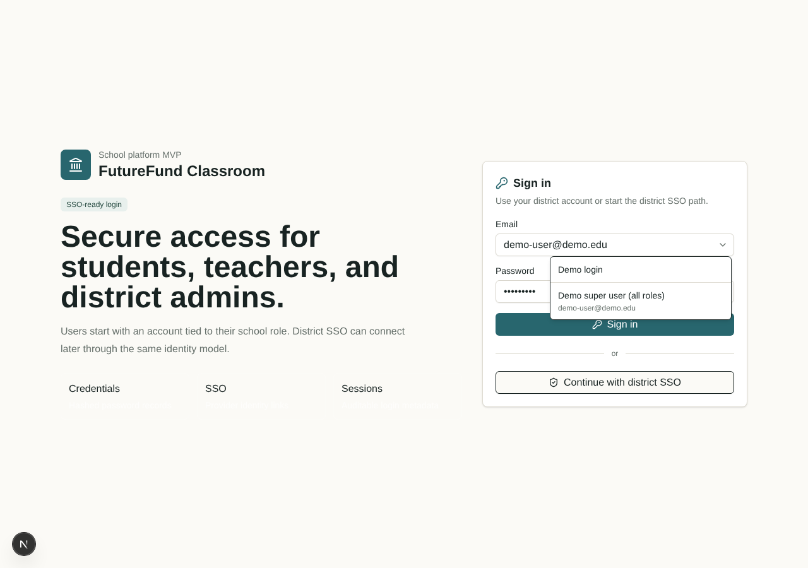
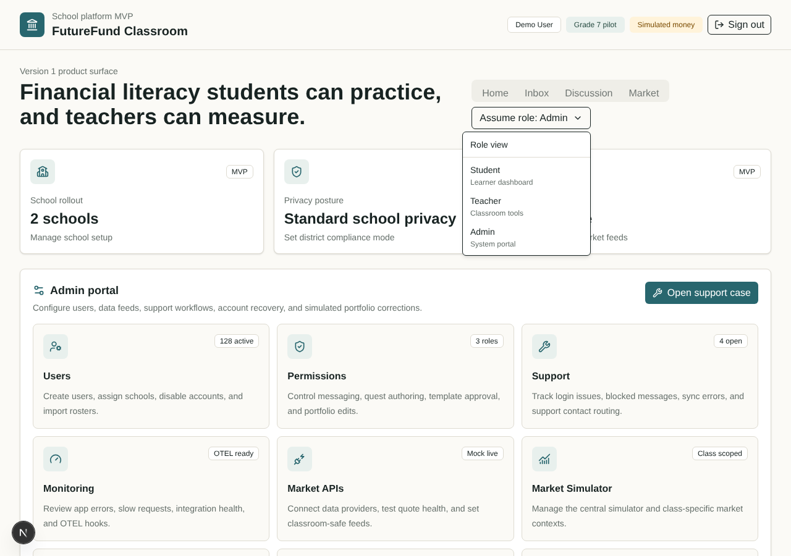
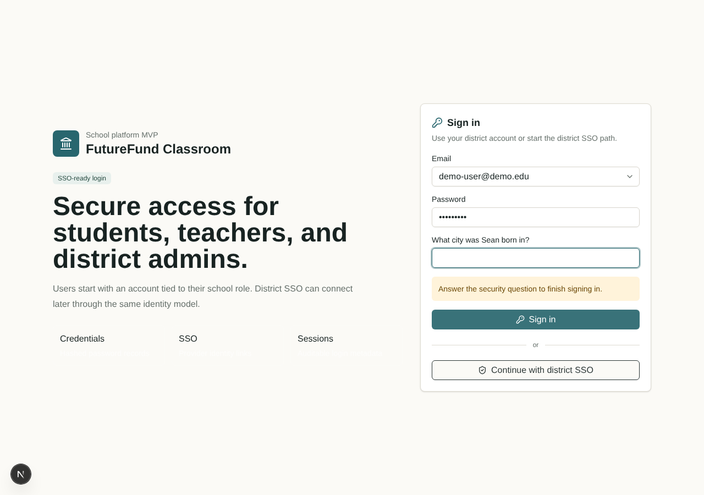
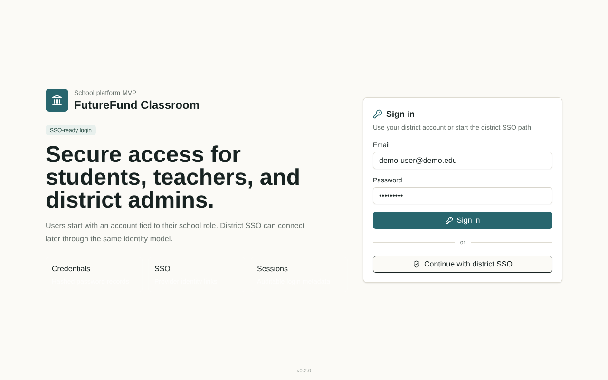
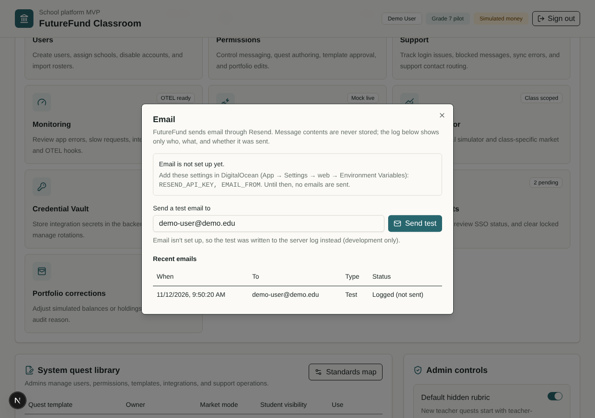
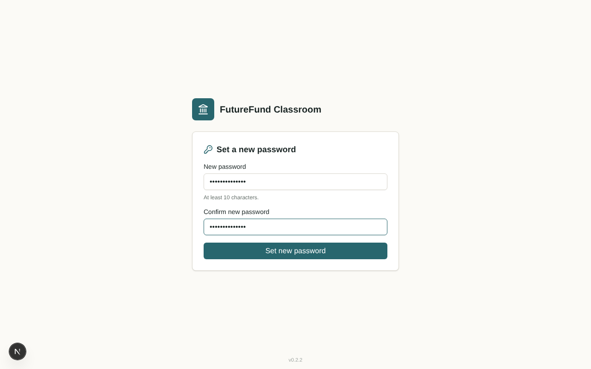
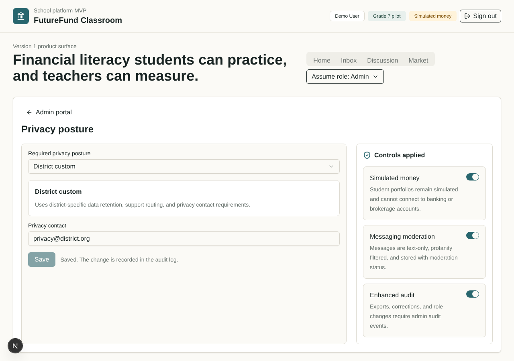

# Test Report: v0.2.0 – v0.2.4

**Date:** 2026-11-12 · **Covers:** v0.2.0 (#1, #2), v0.2.1 (#3–#5), v0.2.2 (#6),
v0.2.3 (#8), v0.2.4 (#9) · **Prepared with:** v0.2.5 (testing setup)

This report records how each update from v0.2.0 to v0.2.4 was tested, the
evidence, and the bugs found. Before v0.2.5, browser checks were one-off
scripts that weren't kept; from v0.2.5 on, they are a permanent suite that runs
automatically on every pull request (see "From v0.2.5 on" below).

## Summary

| Version | What changed | Unit tests | Browser checks | Bugs found |
|---|---|---|---|---|
| v0.2.0 | Demo super user, login dropdown, security question, startup demo seed, versioning, version label | 42 → 49, all passing | Sign-in and role switching (local test accounts and Postgres); security question flow; lockout; version label on both pages | None at the time (one found later: #10) |
| v0.2.1 | Patch notes process, roadmap, versioning rules (docs/process) | 49 passing | n/a (no app changes) | None |
| v0.2.2 | User Manual and Admin Guide review | 49 passing | n/a (docs only); every correction checked against the code | #15 (guides overstated features), #13, #14 identified |
| v0.2.3 | Email (Resend), Admin Email page, password reset email and page | 49 → 61 → 62, all passing | Full reset flow against Postgres; Email page; delivery log and audit records in the database | #10, #11, and a guide error (part of #15) |
| v0.2.4 | Stay signed in on refresh, real sign-out, privacy posture saves | 62 → 66, all passing | Refresh, sign-out, privacy save and reload against Postgres; session revocation and audit records in the database | #12, #13 (fixed), #14 (fixed) |

Every update also ran ESLint on changed files and the TypeScript check, which
held at the 17 errors that existed before v0.2.0 (no new errors).

## Bugs found

All are logged as GitHub issues with the `bug` label and closed as fixed.

| Issue | Bug | Introduced | Found | Fixed |
|---|---|---|---|---|
| [#10](https://github.com/soco104/investing/issues/10) | Demo student `maya.patel` could sign in without the security question (wrong email in the list) | v0.2.0 | v0.2.3 browser testing | v0.2.3 |
| [#11](https://github.com/soco104/investing/issues/11) | Password reset for an unknown email crashed the request | ≤ v0.1.0 | v0.2.3 build | v0.2.3 |
| [#12](https://github.com/soco104/investing/issues/12) | Privacy page values didn't match what the server accepts | ≤ v0.1.0 | v0.2.4 build | v0.2.4 |
| [#13](https://github.com/soco104/investing/issues/13) | Sign out didn't end the session on the server | ≤ v0.1.0 | v0.2.2 review | v0.2.4 |
| [#14](https://github.com/soco104/investing/issues/14) | Refreshing the page signed users out | ≤ v0.1.0 | v0.2.2 review | v0.2.4 |
| [#15](https://github.com/soco104/investing/issues/15) | User Manual and Admin Guide overstated several features | ≤ v0.1.0 | v0.2.2 review, v0.2.3 | v0.2.2, v0.2.3 |

**Lesson from #10:** it was introduced in v0.2.0 and only caught two updates
later, because v0.2.0's browser checks covered the accounts the dropdown
offered, not every seeded account. Two safeguards now exist: a unit test that
checks the security question list against the seed script, and a browser test
that signs in to several demo accounts.

## Evidence by version

### v0.2.0 — Demo super user and security question

Checked in a browser, first with the local test accounts, then against a
real PostgreSQL database with the demo seed loaded:

- Demo dropdown fills in the super user; sign-in succeeds; **Assume role**
  offers Student, Teacher, and Admin.
- Seed script runs twice without duplicates; `demo-user@demo.edu` is stored
  as an Admin with every permission; wrong password returns no user.
- Security question appears only after a correct password; "Boston" is
  rejected with "4 tries left"; "concord" signs in; direct API calls without
  an answer are refused.
- Version label `v0.2.0` at the bottom of the login page and the app.

### v0.2.3 — Email and password resets

Against PostgreSQL, in a browser:

- Migration creates `email_deliveries`; the Email page shows "not set up" and
  which settings are missing; a test send is logged and shown in the table.
- Reset for an unknown email: "No user was found…" (was a crash, #11).
- Reset for a real user: link created (written to the dev log, since email
  isn't configured in testing); the Set new password page enforces 10+
  characters and matching; the new password works; the old one is rejected;
  a used link is rejected; a link with no code shows a clear message.
- Database: delivery log rows (no message contents), audit entries
  (`email.test_sent`, `password_reset.requested`), reset marked completed.
- Found #10 while testing (maya.patel got no security question).
- Not testable from the test environment: delivery through Resend itself
  (covered by unit tests with a simulated Resend).

### v0.2.4 — Sessions and privacy

Against PostgreSQL, in a browser:

- Sign in, refresh: still signed in.
- Privacy page: Save disabled until a change; invalid email rejected;
  "District custom" saved; after a refresh, the saved posture and contact are
  shown; database row and `privacy.updated` audit entry present.
- Sign out, refresh: login page; the session is revoked in the database.

## Gaps at the time (fixed in v0.2.5)

- Browser checks were one-off scripts, not kept, so later updates didn't
  re-check earlier features in a browser.
- Nothing ran automatically on GitHub; results were only in pull request
  descriptions.
- No bug log.

## From v0.2.5 on

- **Browser test suite** (`tests/e2e/`, Playwright, 13 tests) covers
  everything above, including regression tests for #10–#14. First run
  locally against PostgreSQL: **13 passed** (twice in a row).
- **CI on every pull request** (`.github/workflows/ci.yml`): lint, type-check
  baseline (17), unit tests (66), browser tests against PostgreSQL.
- **Test report** posted on each pull request, with downloadable evidence
  (screenshots of every browser test; trace and video of failures).
- **Bug log:** GitHub issues labeled `bug`.
